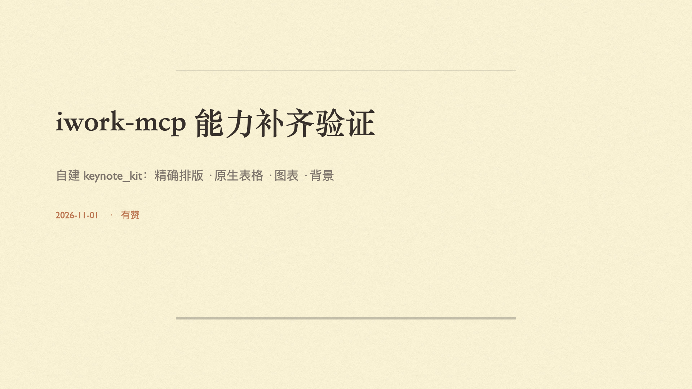
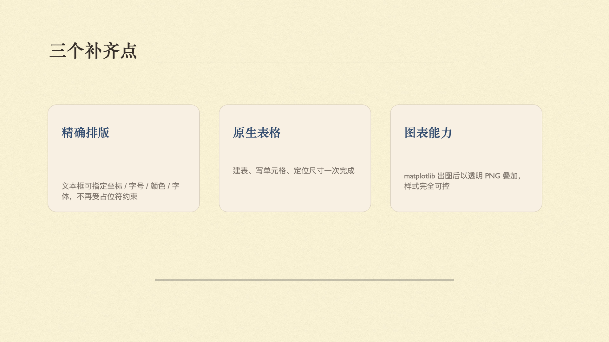
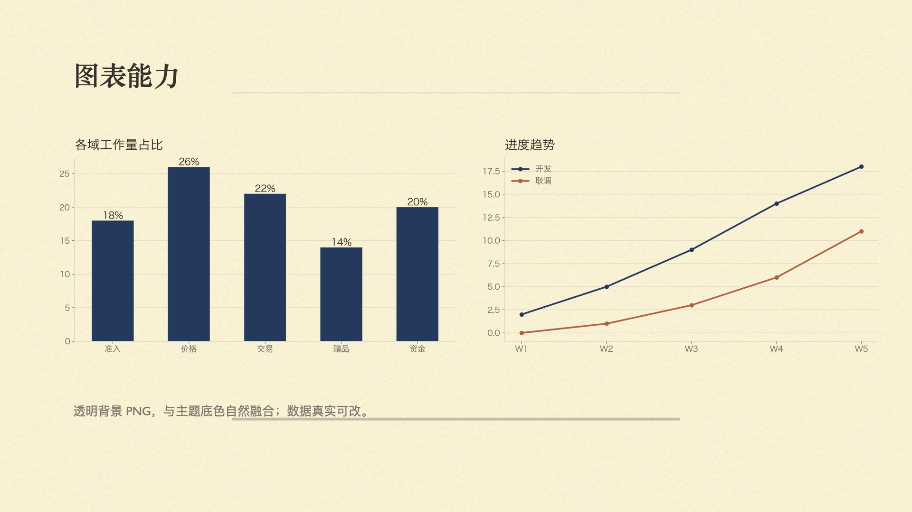

# keynote-kit

**Drive Apple Keynote from Python.** Real `.key` files with exact geometry, native tables,
charts, diagrams and hyperlinks — plus the editing operations Keynote forgot to expose.

[](https://www.python.org/)
[](https://www.apple.com/macos/)
[](LICENSE)
[](docs/mcp-server.md)
[](https://github.com/drakedog0114/keynote-kit/releases)

[English](README.md) · [简体中文](README.zh-CN.md)

---

## Why this exists

Keynote's scripting interface is much thinner than it looks. We ran 25 capability probes
against iwork-mcp 0.8.8 + Keynote Creator Studio 15.4 and kept hitting the same four walls:

| Symptom | Root cause |
|---|---|
| Shapes and tables ignore `x` / `y` and pile up at `(0, 0)` | JXA silently drops the position setter |
| `format_shape` fails with `-1728` | unstable document lookup in the wrapper |
| A missing image path still returns `added: true` | no verification after the write |
| `make new image` / `make new table` / `make new movie` fail with `-10000` | those verbs are broken in 15.x |

`keynote-kit` works around all of them and adds what the interface never had: **precise
layout, positioned native tables, chart rendering, whole-page diagrams, and a real editing
API**.

## At a glance

```python
from keynote_kit import Deck

deck = Deck.create(theme="乳色纸")           # 1920×1080
slide = deck.add_slide("空白")
deck.add_text(slide, "标题文字", 150, 300, 1500, 120, size=84, color="#2B2420")
deck.verify(slide, expect=1)                 # read the page back; failures raise
deck.export("./out/images", "images")
```

| | |
|---|---|
| **Deliverable** | a real `.key` file your client can still edit in Keynote |
| **Import a PPTX** | 4 s for a 22-page deck, 95.4 % pixel fidelity, groups and videos kept |
| **Edit an existing deck** | text, geometry, tables, notes, transitions, whole-deck font swap |
| **MCP server** | 53 tools — no other MCP required |
| **Self-check** | `tools/test_capabilities.py` — 20 assertions against the real app |

## Features

| Module | What it does |
|---|---|
| **Documents** | create with theme & custom canvas size; attach to a running document |
| **Slides** | append with any master layout (safe `at end`, never overwrites); duplicate; delete; reorder |
| **Text** | real text boxes at exact coordinates with size / colour / font; per-paragraph styling |
| **Shapes** | theme-filled shapes with styled labels |
| **Images** | PNG with alpha, large images, full-bleed backgrounds, pre-rendered rounding & cropping |
| **Tables** | native editable tables — create, fill, position, size, merge cells |
| **Charts** | bar / line / donut rendered with matplotlib, transparent background |
| **Diagrams** | swimlane, hierarchy, and two-system integration layouts |
| **Polish** | rounded corners, crop, text auto-fit, z-order, opacity, rotation, hyperlinks, transitions |
| **Editing** | rewrite text, move and resize anything, change the deck's font in one pass |
| **Lines & notes** | straight connectors, speaker notes per slide |
| **PDF** | `export_pdf()` composes PNGs, bypassing Keynote's blank-page bug |
| **Safety** | `verify()` reads the page back so silent failures surface immediately |
| **Export** | per-slide PNG, PowerPoint, PDF, `.key` |

## Requirements

- macOS 14+ with Keynote (verified on macOS 27.0.1 + Keynote Creator Studio 15.4)
- Python 3.10+
- `Pillow` (images / diagrams), `matplotlib` (charts)
- Your terminal must be allowed to control Keynote:
  System Settings → Privacy & Security → Automation

## Install

```bash
git clone https://github.com/drakedog0114/keynote-kit.git
cd keynote-kit
python3 -m venv .venv && source .venv/bin/activate
pip install -e ".[all]"
```

## Quick start

```python
from keynote_kit import Deck, charts

deck = Deck.create(theme="乳色纸")          # 1920×1080 by default
slide = deck.add_slide("空白")

deck.add_text(slide, "标题文字", 150, 300, 1500, 120,
              size=84, color="#2B2420", font="Songti SC Bold")
deck.add_table(slide, [["业务域", "承接方式"], ["准入", "全定制"]], 150, 600, 1600, 240)
deck.add_image(slide, charts.bar_chart(["准入", "价格"], [18, 26], path="bar.png"), 150, 300, 800, 450)

deck.verify(slide, expect=3)                # raises if the counts do not match
deck.export("./out/images", "images")
deck.save("./out/deck.key")
```

### Command line

```bash
python -m keynote_kit.cli new --theme 乳色纸
python -m keynote_kit.cli slide --doc 未命名 --master 空白
python -m keynote_kit.cli text --doc 未命名 --slide 2 --text "标题" \
    --x 150 --y 300 --w 1500 --h 120 --size 84 --color "#2B2420"
python -m keynote_kit.cli export --doc 未命名 --fmt images --out ./out
```

Every subcommand prints JSON, so a shell script or another agent can consume it directly.

## Gallery





*All three pages are generated by `examples/02_demo_deck.py`.*

## Building a page from a spec

`kk_page` takes a declarative page spec — elements in order are z-ordered, the page gets a
background, and the result is read back and verified (rolled back on mismatch):

```python
from keynote_kit import Deck
from keynote_kit.page import apply_page

deck = Deck.create(theme="乳色纸")
slide = deck.add_slide("空白")
apply_page(deck, slide, {
    "background": {"type": "solid", "color": "#F4EBDD"},
    "elements": [
        {"id": "t", "type": "text", "text": "三卡", "box": [150, 110, 1620, 110],
         "style": {"size": 54, "font": "Songti SC Bold"}},
        {"id": "c", "type": "card", "box": [150, 290, 500, 400],
         "style": {"fill": "#FFFFFF", "radius": 26},
         "text": {"title": "整页 Spec", "body": "一页一个 JSON", "valign": "center"}},
        {"id": "ch", "type": "chart", "box": [710, 290, 900, 400],
         "chart": {"kind": "bar", "labels": ["A", "B"], "values": [18, 26]}},
    ],
})
```

Element types: `text` · `card` · `chart` · `diagram` · `image` · `table`.
`kk_extract_page` reads a slide back into a spec.

### Editable text: write into master placeholders

Bare text items cannot inherit theme alignment, bullets or paragraph spacing. Use a master with
placeholders and address them by slot instead — the text stays editable **and** gets the theme's
typography:

```python
deck.add_slide("标题与项目符号")          # master with title + body placeholders
apply_page(deck, 1, {"elements": [
    {"type": "text", "slot": "title", "text": "标题", "box": [150, 90, 1620, 100]},
    {"type": "text", "slot": "body", "text": "第一点\n第二点", "box": [150, 260, 760, 420]},
]})
```

Slot pages skip `clear` and skip the background image (placeholders sit at the bottom of the
z-order, so a full-page image would cover them). Use `card` only for decorative colour blocks.

## Working with a real deck

Client decks get re-used — same structure, new client, new numbers. **Import rather than
rebuild.** Measured on a real 22-page client deck (74 groups, 122 auto shapes):

| route | time | similarity to the source |
|---|---|---|
| **native import** | **4 s** | **95.4 %** |
| rebuild from spec | 596 s | 89.5 % (worst page 49.9 %) |

Native import wins on both axes, so real decks get imported and their **content** changed —
not their geometry. Rebuilding drops auto-shape fills (dark panels come out white), freeforms
and group transforms.

```bash
# 1) import
osascript -e 'tell application "Keynote" to open POSIX file "/path/deck.pptx"'

# 2) rewrite wording, keep formatting
python tools/replace_text.py "deck name" --map rules.json --dry-run
python tools/replace_text.py "deck name" --map rules.json

# 3) audit and export
python tools/audit_styles.py --doc "deck name"
```

`replace_text.py` snapshots each paragraph's size/font/colour, applies the replacements, then
restores the attributes — assigning `object text` wholesale would flatten a 118 pt title and a
66 pt subtitle into one size. Brand names baked into images (screenshots, flow diagrams) are out
of reach for text replacement and have to be regenerated.

### Check the fonts before you judge fidelity

A missing font caps the fidelity of any conversion: Keynote **and** a reference renderer both
silently substitute a fallback, and the two fallbacks differ — so a pixel comparison measures
the difference between two fallbacks, not the design.

```bash
unzip -o deck.pptx -d /tmp/x
grep -oh 'typeface="[^"]*"' /tmp/x/ppt/slides/*.xml | sort | uniq -c | sort -rn
```

`HarmonyOS Sans SC` is Apache-2.0 and free (<https://github.com/huawei-fonts/HarmonyOS-Sans>).

### Comparing two renders

```bash
soffice --headless --convert-to pdf deck.pptx && pdftoppm -png -r 72 deck.pdf /tmp/ref
python tools/compare.py /tmp/ref /tmp/out --min 90
```

Prints average / median / worst similarity per page and exits non-zero below `--min`.

## Visual polish

```python
{"type": "image", "path": "photo.jpg", "box": [60, 160, 700, 350],
 "style": {"radius": 40, "crop": "cover"}}     # rounded, cropped
{"type": "text", "text": long_copy, "box": [80, 300, 760, 150],
 "style": {"size": 42}}                        # auto-fit is on by default ("auto")
{"type": "rich", "box": [100, 300, 900, 140], "link": "https://example.com",
 "paragraphs": [{"align": "left", "runs": [{"text": "link", "size": 24}]}]}
```

```python
from keynote_kit.animate import set_transition, set_opacity, bring_to_front
set_transition(doc, slide, "magic move", duration=0.6)
set_opacity(doc, slide, "image", 1, 0.4)
bring_to_front(doc, slide, "image", 1, "/path/to/image.png")
```

Keynote has no crop, autoFit, z-index or hyperlink API — those are computed or
pre-rendered locally.

`style.fit` takes three values: `"auto"` (default — only shrinks when something is clearly
wrong), `True` (always shrink until it fits) and `False` (never touch it). The default is not
`True` because Keynote text boxes never clip: a 96 pt title in a deliberately tight 60 pt box
is a design choice, not a bug.

### Progressive reveal instead of build animations

"Appear / fly in" has no API at all. The reliable substitute is to split the page and
connect the pieces with transitions:

```python
from keynote_kit.build import build_bullets, build_reveal

build_bullets(deck, slide=4, spec=SPEC, bullet_element="b")   # title + 3 bullets → 4 pages
build_reveal(deck, slide=4, spec=SPEC,
             groups=[["title"], ["title", "chart"], ["title", "chart", "card"]])
```

Everything stays native Keynote — no UI automation.

## Editing capabilities

`tools/probe_editing.py` probes **editing** (as opposed to creating) against the real app.
Current state, verified by reading the value back:

| Operation | Status | Notes |
|---|---|---|
| Replace a text box's content | ✅ | paragraph size/font/colour survive |
| Add or remove a paragraph | ✅ | `set object text to a & return & b` |
| Move an element | ✅ | |
| Resize an element | ✅ | |
| Delete an element | ✅ | |
| Change paragraph size / colour / font | ✅ **via JXA only** | the AppleScript `paragraph` class exposes *no* properties |
| Change table cell text | ✅ | |
| Merge / unmerge cells | ✅ | `merge (range "A1:B1" of table 1 of slide N of it)` |
| Add or delete table rows | ❌ | no such command in the sdef |
| Cell colour, row height | ❌ | |
| Duplicate a text box or image | ❌ | `Text items can not be copied. (-1717)` |
| Slide transitions, opacity, rotation | ✅ | rotation: shapes and images, not text boxes |
| Add / delete / duplicate slides | ✅ | |
| Speaker notes | ✅ | `presenter notes of slide N` |
| Switch master layout | ✅ | `base layout of slide N` |
| Hide the title placeholder | ✅ | `title showing of slide N` |
| Slide background fill | ❌ | read-only |
| Change the canvas size | ✅ | |
| Replace the font across a whole deck | ✅ | |
| Change a document's name | ✅ **via JXA only** | AppleScript refuses |
| Paragraph alignment | ❌ | set it in the RTF at creation time instead |
| Build animations | ❌ | no API — use *progressive reveal* |

Two traps worth knowing: the colour **setter** takes `0–65535` but the **getter** returns
`0–1` floats; and `slide.textItems[length - 1]` is *not* the element you just created —
theme placeholders enumerate after pushed items, so always style the local reference.

## Shrinking an existing deck

Keynote has no "reduce file size" command. `tools/compress_deck.py` rewrites the package media
(video re-encode + image resample) and accepts the result by comparing two decks page by page:

```bash
python tools/compress_deck.py original.key -o compressed.key --verify original.key
# 59 pages compared, 0 differing    (real 59-page deck: 450 MB → 95 MB)
```

Read the traps first: [docs/compression.md](docs/compression.md).

## MCP server

`keynote-kit` ships a complete MCP server — **no other MCP is required**. 53 tools cover
documents, slides, text, shapes, images, tables, charts, diagrams, layout, notes, export and
presentation control.

```bash
python -m keynote_kit.mcp_server
```

```json
{
  "mcpServers": {
    "keynote-kit": { "command": "python3", "args": ["-m", "keynote_kit.mcp_server"] }
  }
}
```

Full tool list and per-client setup: [docs/mcp-server.md](docs/mcp-server.md).

## Documentation

| Doc | EN | 中文 | Contents |
|---|---|---|---|
| Capability matrix | [capabilities.md](docs/capabilities.md) | [中文](docs/capabilities.zh-CN.md) | What Keynote can and cannot do, item by item |
| Scripting traps | [gotchas.md](docs/gotchas.md) | [中文](docs/gotchas.zh-CN.md) | 17 Keynote defects and their workarounds |
| MCP server | [mcp-server.md](docs/mcp-server.md) | [中文](docs/mcp-server.zh-CN.md) | 53 tools, client configs, migration table |
| Diagrams | [diagrams.md](docs/diagrams.md) | [中文](docs/diagrams.zh-CN.md) | Data specs for swimlane / hierarchy / integration |
| **Deck compression** | [compression.md](docs/compression.md) | [中文](docs/compression.zh-CN.md) | Shrinking `.key` files safely, and the four traps |
| **Visual polish** | [visuals.md](docs/visuals.md) | [中文](docs/visuals.zh-CN.md) | Rounded images, text auto-fit, z-order, transitions, hyperlinks |
| **Client swap** | [client-swap.md](docs/client-swap.md) | [中文](docs/client-swap.zh-CN.md) | Import, rewrite, re-brand, verify — the full checklist |
| **Quality guide** | [quality-guide.md](docs/quality-guide.md) | [中文](docs/quality-guide.zh-CN.md) | What "good" looks like, and how to check it |
| MCP integration | [mcp-integration.md](docs/mcp-integration.md) | [中文](docs/mcp-integration.zh-CN.md) | Co-existing with other MCP servers |
| Examples | [examples/](examples/) | — | hello deck, full demo, diagram gallery, end-to-end |

## Project layout

```
keynote_kit/
  runner.py      JXA + AppleScript runners with unified error handling
  deck.py        Deck / slide / element / geometry / style / export
  charts.py      matplotlib charts (transparent, CJK-ready)
  diagrams.py    swimlane, hierarchy, integration renderers
  page.py        declarative page spec: compile, verify, roll back
  imaging.py     image rounding / cropping, text measurement and auto-fit
  animate.py     transitions, opacity, rotation, z-order
  build.py       progressive reveal (replaces build animations)
  cli.py         JSON-emitting command line
examples/        runnable scripts
tools/           capability probes, deck audit, page comparison, MCP clients
docs/            capability matrix, gotchas, quality guide, MCP integration notes
tests/           smoke tests (require Keynote)
```

## Known limitations

| Wanted | Reality |
|---|---|
| Build animations ("appear", "fly in") | no API — use *progressive reveal* instead |
| Pasting in the background | impossible — Cmd+V needs Keynote in front. The library refuses to steal the focus unless you set `KK_TAKEOVER=1` |
| Image crop & mask | no API — pre-rendered locally |
| Single-page background fill, master editing | no script-level API (`slide layout` is read-only) |
| Table cell colour, row height, add/remove rows | not exposed |
| Paragraph alignment | set it in the RTF at creation time |
| Duplicate an element | `duplicate` fails for text items and images |

Full list: [docs/gotchas.md](docs/gotchas.md).

## Roadmap

Design proposals live in [docs/rfc/](docs/rfc/). RFC 0001 introduced the declarative page spec
(`kk_page`, shipped in 0.2.0). Still open: collapsing the tool surface to ~12, a
`clients/*.json` template for repeat client swaps, and native rebuilds for pages whose body is
a single image.

## Contributing

Issues and PRs are welcome — see [CONTRIBUTING.md](CONTRIBUTING.md).
If you find a new Keynote scripting trap, please add it to [docs/gotchas.md](docs/gotchas.md)
with a minimal repro.

## License

[MIT](LICENSE)
