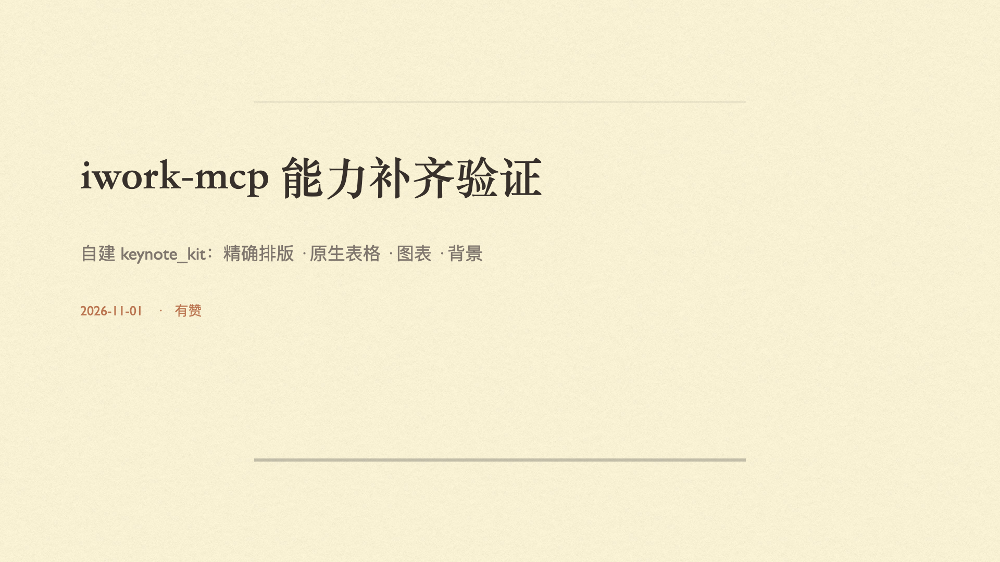
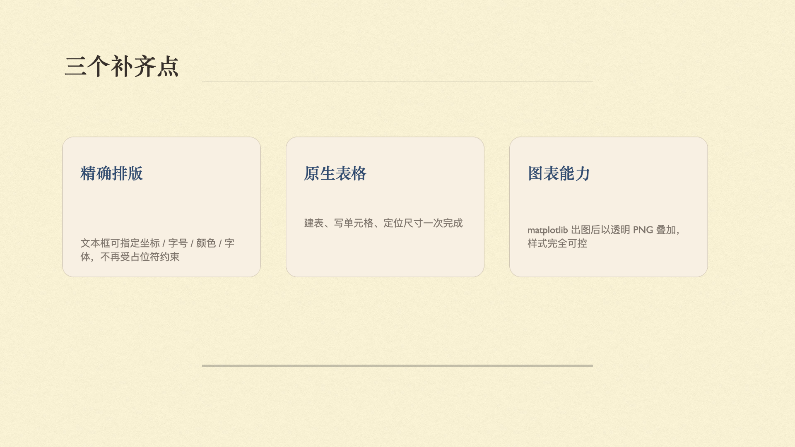
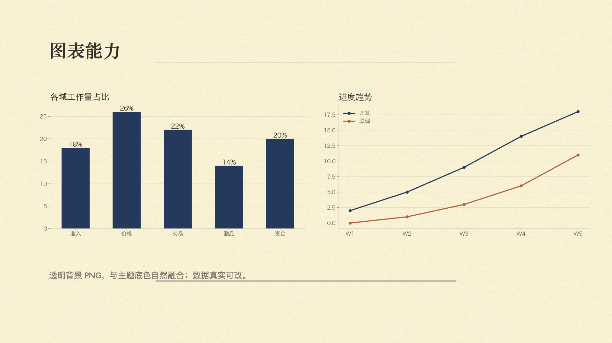

# keynote-kit

> 用 Python 精确驱动 Apple Keynote：精确排版、原生表格、图表与信息图。

[English](README.md) · **简体中文**

---

## 为什么做这个

Keynote 的脚本接口（AppleScript / JXA）比看上去薄得多。我们对 iwork-mcp 0.8.8 + Keynote Creator
Studio 15.4 做了 25 项能力测试，反复出现三类问题：

| 现象 | 根因 |
|---|---|
| 形状、表格忽略 `x`/`y`，全部堆在 `(0, 0)` | JXA 的 position setter 被静默丢弃 |
| `format_shape` 报 `-1728` | 封装层的文档查找不稳定 |
| 图片路径不存在却返回 `added: true` | 写入后没有校验 |
| `make new image` / `make new table` / `make new movie` 报 `-10000` | 15.x 里这几个动词已损坏 |

`keynote-kit` 绕过了这些问题，并补上了接口层从来没有的能力：**排版控制、带位置的原生表格、
图表渲染、整页信息图**。

## 能力一览

| 模块 | 能力 |
|---|---|
| 文档 | 按主题与自定义画布尺寸创建；接管已打开文档 |
| 页面 | 用任意母版追加（安全追加，不会覆盖相邻页） |
| 文本 | 真正的文本框，坐标 / 字号 / 颜色 / 字体可控 |
| 形状 | 主题填充的形状 + 可设样式标签 |
| 图片 | 支持透明 PNG、大图、整页背景 |
| 表格 | 原生可编辑表格，建表、填充、定位、定尺寸 |
| 图表 | matplotlib 渲染柱状 / 折线 / 环形，透明背景 |
| 信息图 | 泳道图、层级图、双端集成图 |
| 安全 | `verify()` 回读页面，静默失败立刻暴露 |
| 导出 | 逐页 PNG、PowerPoint、PDF、`.key` |

## 环境要求

- macOS 14+，已安装 Keynote（在 macOS 27.0.1 + Keynote Creator Studio 15.4 上验证）
- Python 3.10+
- `Pillow`（图片 / 信息图）、`matplotlib`（图表）
- 终端需被允许控制 Keynote：系统设置 → 隐私与安全性 → 自动化

## 安装

```bash
git clone https://github.com/<you>/keynote-kit.git
cd keynote-kit
python3 -m venv .venv && source .venv/bin/activate
pip install -e ".[all]"
```

## 快速开始

```python
from keynote_kit import Deck, charts

deck = Deck.create(theme="乳色纸")          # 默认 1920×1080
slide = deck.add_slide("空白")

deck.add_text(slide, "标题文字", 150, 300, 1500, 120,
              size=84, color="#2B2420", font="Songti SC Bold")
deck.add_table(slide, [["业务域", "承接方式"], ["准入", "全定制"]], 150, 600, 1600, 240)
deck.add_image(slide, charts.bar_chart(["准入", "价格"], [18, 26], path="bar.png"), 150, 300, 800, 450)

deck.verify(slide, expect=3)                # 数量不符会抛异常
deck.export("./out/images", "images")
deck.save("./out/deck.key")
```

### 命令行

```bash
python -m keynote_kit.cli new --theme 乳色纸
python -m keynote_kit.cli slide --doc 未命名 --master 空白
python -m keynote_kit.cli text --doc 未命名 --slide 2 --text "标题" \
    --x 150 --y 300 --w 1500 --h 120 --size 84 --color "#2B2420"
python -m keynote_kit.cli export --doc 未命名 --fmt images --out ./out
```

所有子命令输出 JSON，便于 shell 或其他 agent 直接消费。

## 效果





*以上页面均由 `examples/02_demo_deck.py` 生成。*

## MCP 服务

`keynote-kit` 自带**完整**的 MCP 服务，**不需要再装 iwork-mcp 或任何其他 MCP**。41 个工具覆盖
文档、页面、文本、形状、图片、表格、图表、信息图、版式、备注、导出与放映控制。

```bash
python -m keynote_kit.mcp_server
```

```json
{
  "mcpServers": {
    "keynote-kit": { "command": "python3", "args": ["-m", "keynote_kit.mcp_server"] }
  }
}
```

完整工具清单与各客户端配置：[docs/mcp-server.md](docs/mcp-server.md)。

## 文档

| 文档 | 内容 |
|---|---|
| [docs/capabilities.md](docs/capabilities.md) | 28 项能力矩阵：keynote-kit vs iwork-mcp vs 原生脚本 |
| [docs/gotchas.md](docs/gotchas.md) | Keynote 脚本的 10 个坑与对应解法 |
| [docs/mcp-integration.md](docs/mcp-integration.md) | 与 MCP 服务器共存的两种方式 |
| [examples/](examples/) | 可直接运行的示例 |

## 已知限制

以下能力 Keynote 完全没有开放接口，只能靠 UI 自动化或等原生 MCP：

- 动画 / 构建效果
- 图片裁剪与遮罩
- 单页背景填充与母版编辑（`slide layout` 只读）
- 表格填充色（只能改单元格文字颜色）

## 许可

[MIT](LICENSE)
